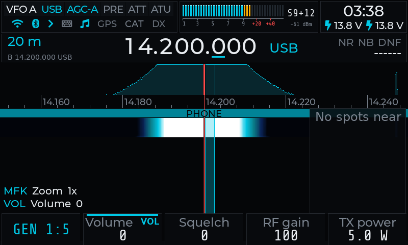
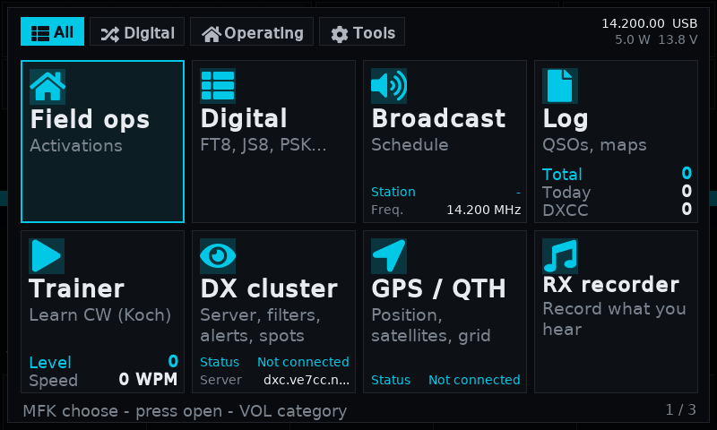
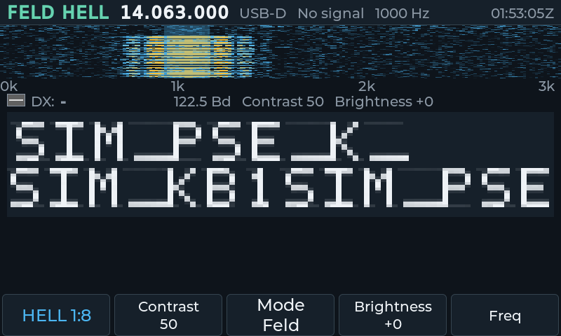
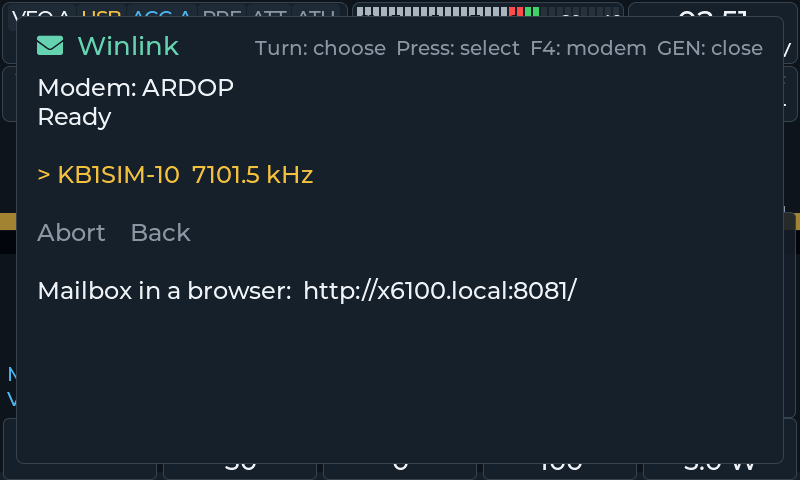

<h1 align="center">X6100 Link</h1>

<i>by Giovanni Ricciardi IU1WXY</i> · <a href="https://x6100-link.it"><b>x6100-link.it</b></a>

A complete microSD firmware for the Xiegu X6100. From version 0.2 its
interface (x6ng) and the library that talks to the radio (x6radio) are written
from scratch: digital modes on the radio (FT8, FT4, JS8, WSPR, PSK, RTTY,
Olivia, Hellschreiber, SSTV, WeFax, NAVTEX, DSC, HF APRS, FreeDV), Winlink over
the internet or over the air (ARDOP or VARA HF compatible), CW keyer and
decoder, DX cluster, Broadcast, SOTA/POTA/WWFF/GMA, a 3D waterfall, themes, a
web configurator and the X6100 Link app for Android.

## Companion app: X6100 Link for Android

The firmware has a companion app, **X6100 Link**, for Android phones and
tablets: the radio's controls, spectrum and waterfall, audio both ways, FT8,
JS8 and the other digital modes, FreeDV on the phone, Winlink mail, the log,
DX cluster and SOTA/POTA, over Wi-Fi, the phone's hotspot or a VPN.
App page, docs and screenshots: **[github.com/IU1WXY/X6100-Link](https://github.com/IU1WXY/X6100-Link)**.

This repository holds the releases only: the microSD image, the GPL sources
of each version, the terms of use and the third-party licences.

## Install

1. Download `x6100-iu1wxy-<version>-sdcard.img` from the
   **[latest release](https://github.com/IU1WXY/X6100-IU1WXY/releases/latest)**
   and check it against its `.sha256` file.
2. Write it to a microSD card with [balenaEtcher](https://etcher.balena.io/) or Raspberry Pi Imager.
3. Put the card in the radio and switch on.

Recommended base firmware: Georgy Dyuldin's patched baseband r13.
Wi-Fi networks and Bluetooth pairings are kept when you rewrite the card.

## Manual

**[x6100-link.it](https://x6100-link.it)**. Problems and ideas:
[x6100-link.it/report.php](https://x6100-link.it/report.php).

## Licence

The X6100 Link software (x6ng, x6radio, the web configurator, their scripts
and data) is Copyright (c) 2026 Giovanni Ricciardi IU1WXY, all rights
reserved, and is used under the [terms of use](LICENSE). In short: you may
install and use it free of charge on your X6100, keep copies and pass the
unmodified image to other X6100 owners free of charge. You may not sell it,
modify it, reverse engineer it or present it as your own work, except where
the law or the licences of the third-party parts allow it. It comes without
any warranty. Versions up to 0.127 stay under the licences they were
published with.

The image also holds software by other authors under their own licences
(Linux, BusyBox, U-Boot, glibc and the system libraries, LVGL, cJSON, ft8_lib,
KISS FFT, codec2, the SSTV libraries by Hany El Imam, Pat, ardopcf, XARA, the
JS8 dictionary, the fonts and more). Those licences apply in full: the list and
the texts are in [THIRD_PARTY_LICENSES](THIRD_PARTY_LICENSES), and on the radio
in `/usr/share/x6100/licenses/` and `/usr/share/licenses/x6ng/`.

## GPL sources

Each release has the file `X6100-IU1WXY-v<version>-gpl-sources.tar.gz` among
its assets: the source of the GPL, LGPL and MPL parts of that image, the
kernel configuration and patches, the WiFi driver patches, the buildroot tree
and its legal-info. The same source can be requested at info@x6100-link.it.

## Privacy

What the radio sends, to whom and why is in the privacy notice:
[x6100-link.it/privacy.php](https://x6100-link.it/privacy.php).

X6100 Link is not affiliated with Xiegu.
